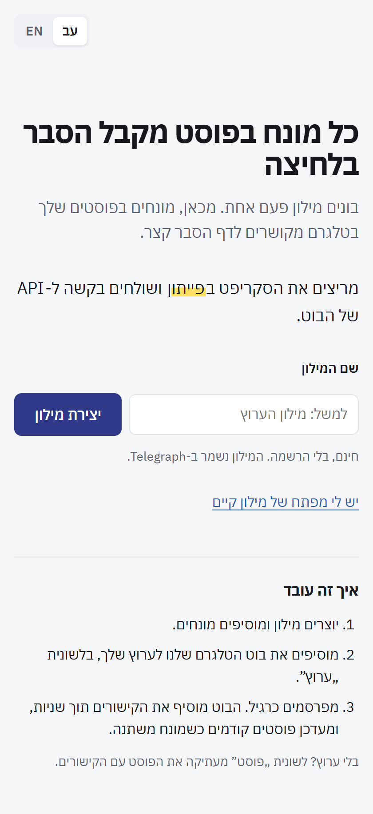
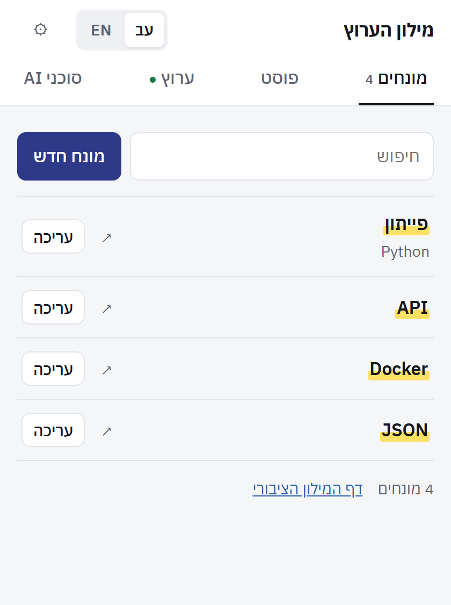
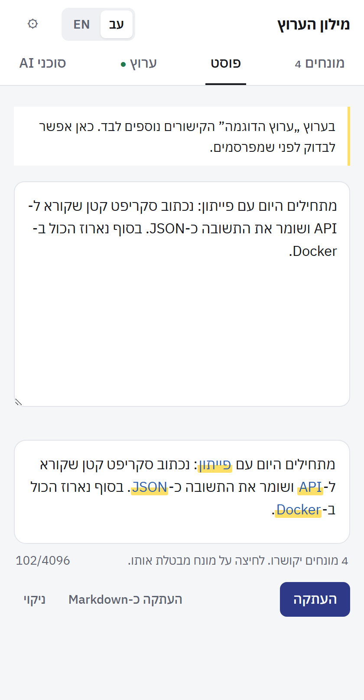
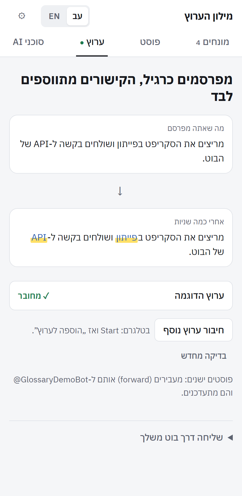

# Telegraph Glossary

**Every term in your Telegram posts, explained in one tap.**

You build a glossary once. Each term becomes a short [Telegraph](https://telegra.ph) page
(it opens instantly inside Telegram), and terms in your posts link to it.

> בונים מילון פעם אחת, ומונחים בפוסטים שלך בטלגרם מקושרים לדף הסבר קצר.

**Web app:** https://nehoraihadad.github.io/telegraph-glossary/

<p>
  
  
  
  
</p>

## For users

1. **Create a glossary.** Give it a name. No sign-up.
2. **Add terms.** Each term has a short explanation, plus *other forms* such as the plural, the English name or an acronym.
   Hebrew prefixes (בפייתון, ל-API) are matched automatically.
3. **Connect your channel** (Channel tab). Press Start in the bot and add it to the channel.
   From then on you post as usual, and the bot adds the links within seconds. When you add a term,
   earlier posts are updated too. To update older posts, forward them to the bot.
4. **Save your key** (Settings). It is the only way back to your glossary.

No channel? The **Post** tab shows which terms will be linked and copies the post with its links.

**Inside Telegram:** the bot's menu button (or `/app`) opens the same app as a Telegram Mini App.
Telegram signs you in, and your key is kept in your own Telegram cloud storage, not on our servers,
so it's there on every device. Outside Telegram, the key is your responsibility: download it, or
save it to Saved Messages with one tap.

## For AI agents

Any MCP-capable agent can manage the glossary: Claude Code, Codex, Gemini CLI, Antigravity,
Cursor, Claude Desktop. The **AI agents** tab in the web app gives a ready command with your key.
It requires [uv](https://docs.astral.sh/uv/).

```bash
claude mcp add telegraph-glossary --scope user -e TELEGRAPH_ACCESS_TOKEN=<KEY> -- \
  uvx --from git+https://github.com/NehoraiHadad/telegraph-glossary telegraph-glossary mcp
```

Then ask, for example: *"Which terms from this post are missing from my glossary?"*

| Tool | What it does |
|---|---|
| `glossary_info` | title, public page, term count, whether a channel is auto-linked |
| `list_terms` `get_term` `add_term` `update_term` `remove_term` | manage terms (definitions in Markdown) |
| `add_terms` | add or update many terms in one call |
| `rename_glossary` `export_glossary` | rename; all terms with definitions as Markdown or JSON |
| `edit_on_telegraph` | one-time link that signs the browser in to telegra.ph |
| `relink_channel` | re-apply the glossary to the channel's posts now |
| `link_text` | the post as Telegram HTML with links, plus the terms found |
| `connect_channel` `channel_status` | connect a channel to the auto-link bot |
| `send_to_telegram` | send through your own bot (`TELEGRAM_BOT_TOKEN`) |
| prompt `link_post` | link a post and suggest missing terms |

Agents that browse can read [`llms.txt`](web/llms.txt). The CLI does the same from a terminal:
`telegraph-glossary init | add | list | link | channel connect | ...` (`tgg` for short).

## For the owner: deploy

Both deploy on every push to `main`, and no deploy secrets live in GitHub.

1. **Site:** `.github/workflows/deploy.yml` publishes `web/` to GitHub Pages
   (one-time: **Settings → Pages → Source: GitHub Actions**).
2. **Bot:** Cloudflare Workers Builds, connected to this repo in the Cloudflare dashboard. The bot's
   address is in [`web/config.json`](web/config.json), which is how the site, the CLI and the MCP
   server find it. Setup and details: [bot/README.md](bot/README.md).

## Development

Contributing (architecture, rules, secrets, tests): [AGENTS.md](AGENTS.md).

```
web/       static web app (no build step)
  core/    linker, Telegram entities, Markdown <-> Telegraph, storage (shared with bot/)
bot/       auto-link bot, Cloudflare Worker
src/       Python package: CLI + MCP server
spec/      linker cases both implementations must pass
e2e/       full local run: site + Worker + fake Telegram, in a real browser
docs/      FORMAT.md, how a glossary is stored on Telegraph
```

```bash
node --test web/tests/*.mjs bot/tests/*.mjs     # JS units + bot flows
pip install -e . pytest && pytest               # Python
e2e/run.sh                                      # end to end (Playwright + wrangler)
python -m http.server -d web                    # run the site locally
```

Related: [telegraph-mcp](https://github.com/NehoraiHadad/telegraph-mcp),
[telegraph-mcp-py](https://github.com/NehoraiHadad/telegraph-mcp-py),
[telegraph-js](https://github.com/NehoraiHadad/telegraph-js),
[telegraph-py](https://github.com/NehoraiHadad/telegraph-py).
