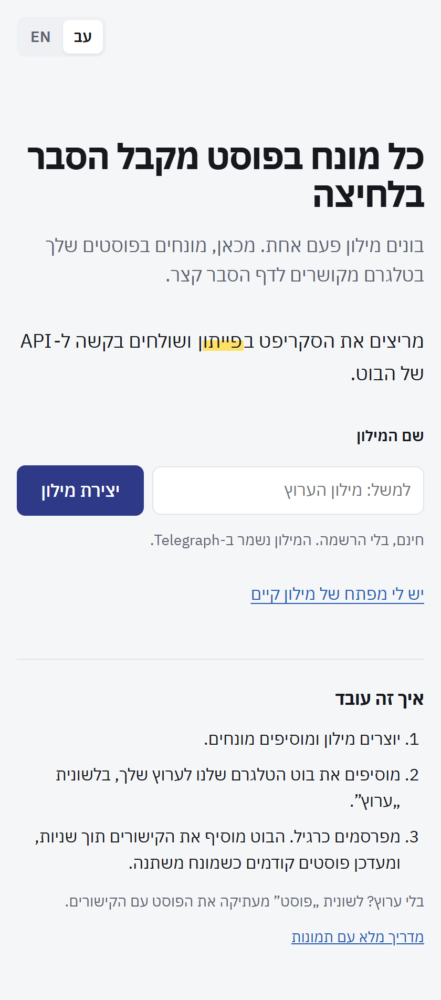
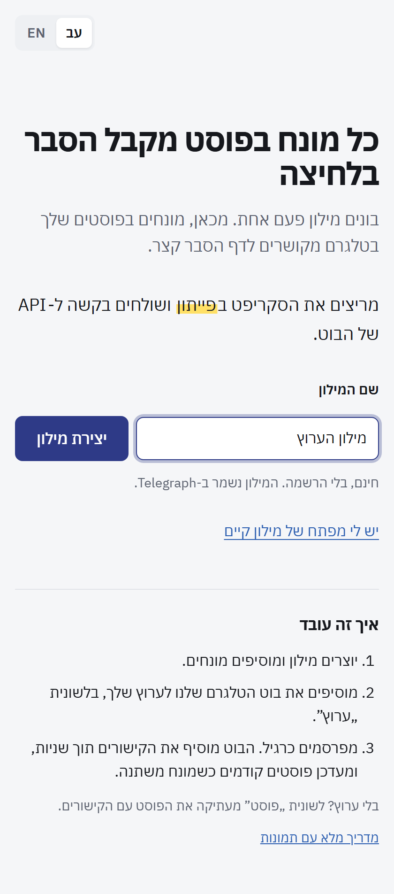
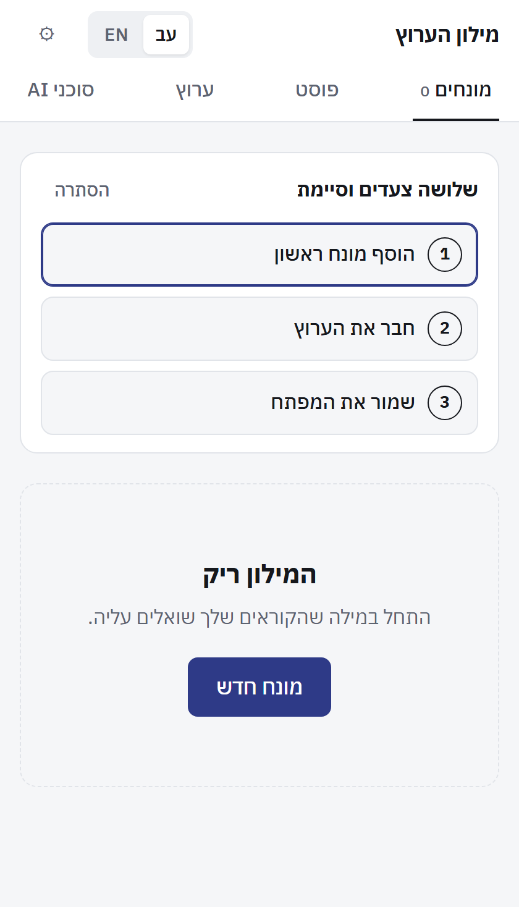
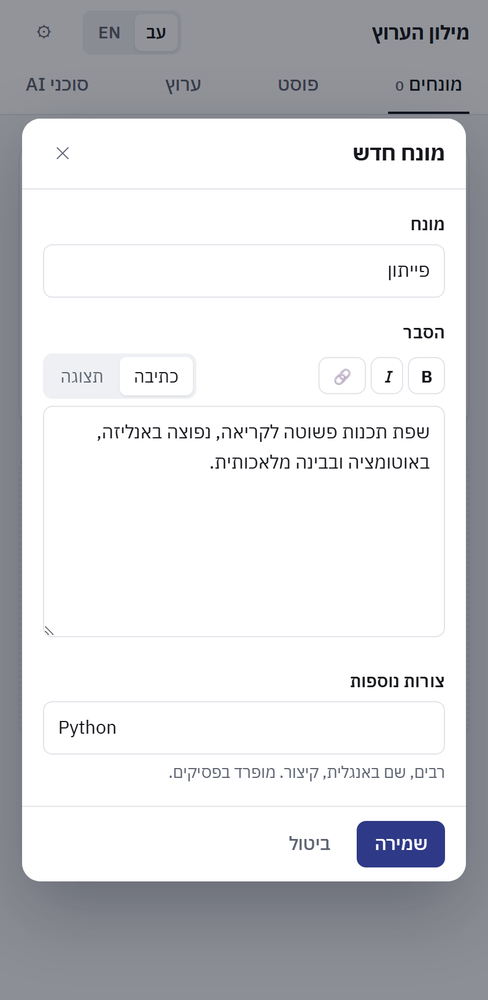
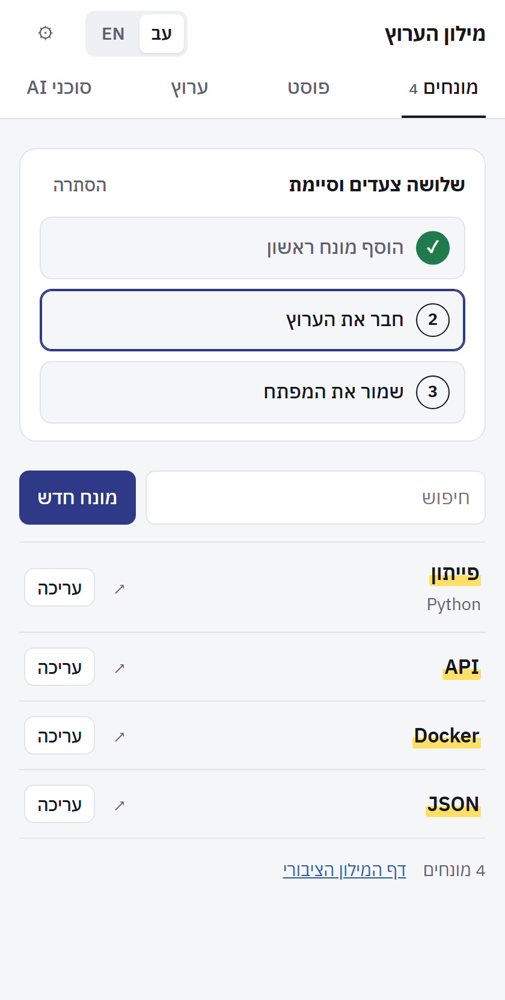
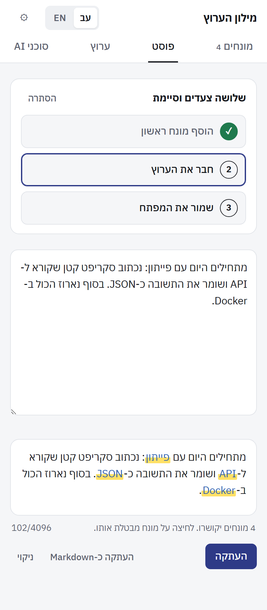
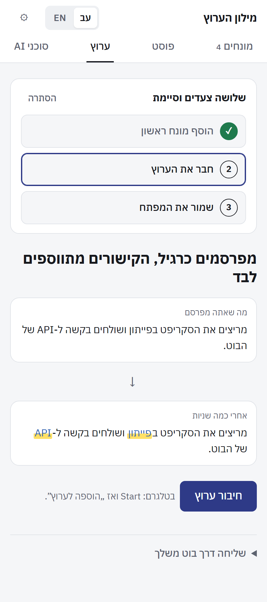
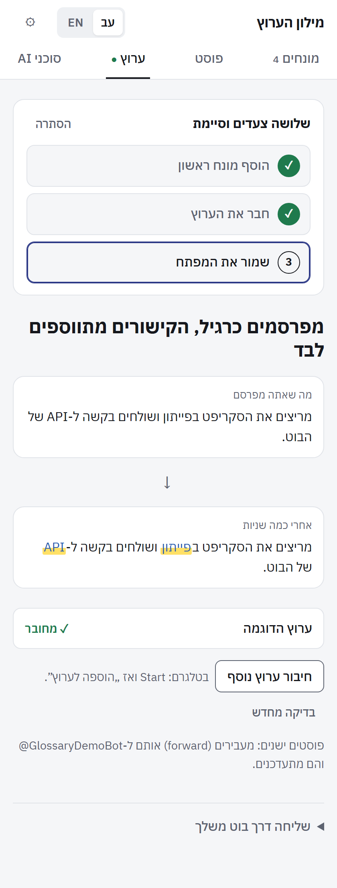
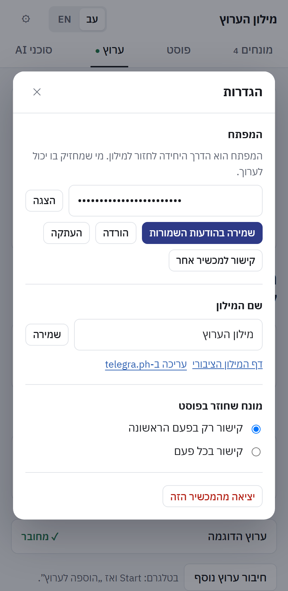

# התחלה מהירה: מדריך בתמונות

מדף ריק ועד ערוץ טלגרם שבו כל מונח בפוסט מקושר להסבר.
English: [GUIDE.md](GUIDE.md). פותחים את האפליקציה:
https://nehoraihadad.github.io/telegraph-glossary/

## 1. פותחים את האפליקציה

בלי הרשמה. הדף מסביר איך זה עובד ומבקש שם למילון.

## 2. נותנים שם למילון

כותבים שם ולוחצים **יצירת מילון**. המילון נשמר ב-Telegraph, בחינם.

## 3. המילון ריק

הרשימה בראש המסך מראה מה נשאר: להוסיף מונח, לחבר ערוץ, לשמור את המפתח.

## 4. מוסיפים מונח

כותבים את המונח והסבר קצר. ב**צורות נוספות** מוסיפים רבים, שם באנגלית או קיצור, מופרדים בפסיקים.
תחיליות בעברית (כמו בפייתון) מזוהות אוטומטית.

## 5. מוסיפים עוד כמה

כל מונח הוא דף Telegraph משלו, שנפתח מיד בתוך טלגרם.

## 6. מנסים פוסט

בלשונית **פוסט** כותבים או מדביקים פוסט. המונחים שיקושרו מסומנים. לחיצה על סימון מבטלת אותו.
**העתקה** נותנת את הפוסט עם הקישורים, מוכן להדבקה בטלגרם. זה כל מה שצריך אם אין לך ערוץ.

## 7. מחברים את הערוץ

בלשונית **ערוץ** לוחצים **חיבור ערוץ**. נפתח קישור לטלגרם.

**בטלגרם:**

1. הקישור פותח את הבוט. לוחצים **Start**.
2. הבוט מציע **הוספה לערוץ**. לוחצים ובוחרים את הערוץ.
3. משאירים את ההרשאה **עריכת הודעות** פעילה. הבוט צריך אותה כדי להוסיף את הקישורים.

חוזרים לאפליקציה. אם היא לא התעדכנה לבד, לוחצים **בדיקה מחדש**.

## 8. מחובר

הערוץ מופיע כמחובר. מעכשיו מפרסמים כרגיל, והבוט מוסיף את הקישורים תוך שניות.
כשמוסיפים או משנים מונח, גם פוסטים קודמים מתעדכנים.

פוסטים ישנים, מלפני החיבור: מעבירים (forward) אותם לבוט והוא מעדכן את המקור.

אפשר גם לפתוח את האפליקציה בתוך טלגרם, כ-Mini App: שולחים לבוט `/app` או משתמשים בכפתור
התפריט שלו. טלגרם מזהה אותך ושומרת את המפתח באחסון הענן האישי שלך.

## 9. שומרים את המפתח

המפתח הוא הדרך היחידה לחזור למילון, ומי שמחזיק בו יכול לערוך. שומרים אותו בהודעות השמורות,
מורידים, מעתיקים, או מעתיקים קישור למכשיר אחר. הבוט לא רואה אותו.

## עוד

* סוכני AI (Claude Code, Codex, Gemini CLI ועוד) יכולים לנהל את המילון דרך הלשונית
  **סוכני AI**. ראו את [README](../README.md).
* יצירה מחדש של התמונות: `NODE_PATH=$(npm root -g) node e2e/guide.cjs`. הסקריפט רץ ללא רשת,
  עם Telegraph ובוט מדומים.

