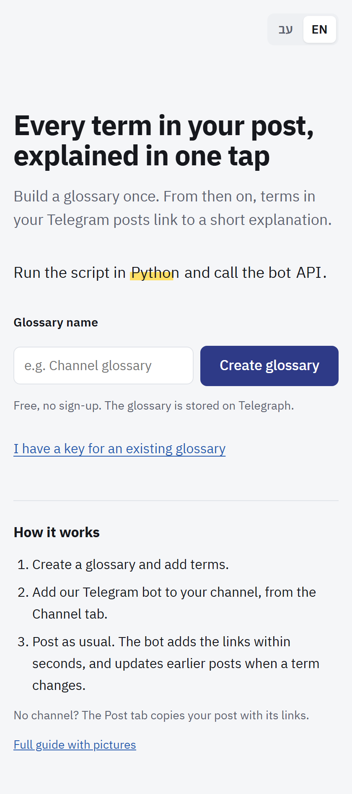
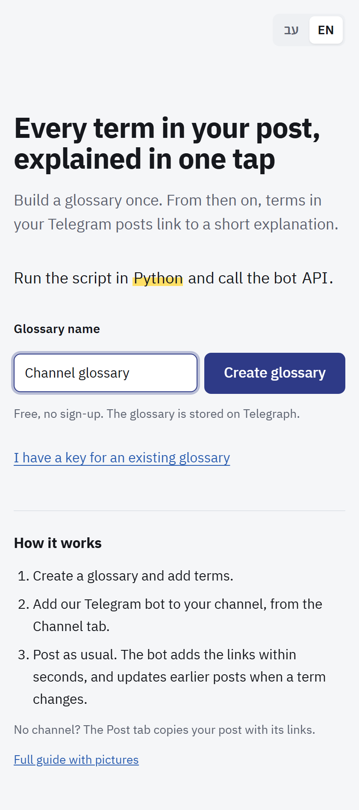
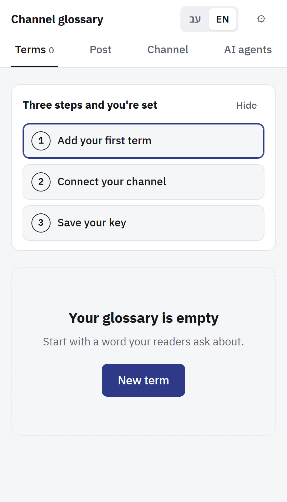
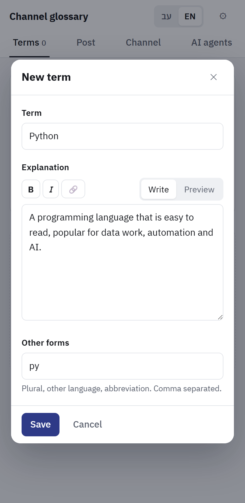
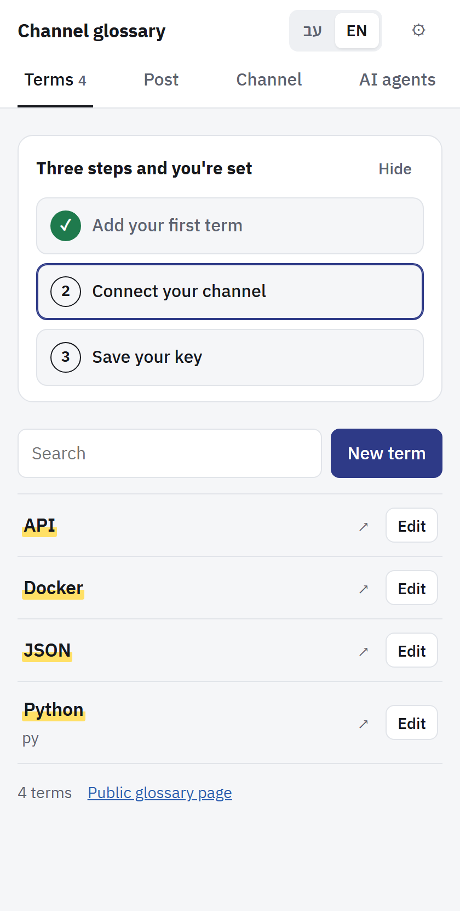
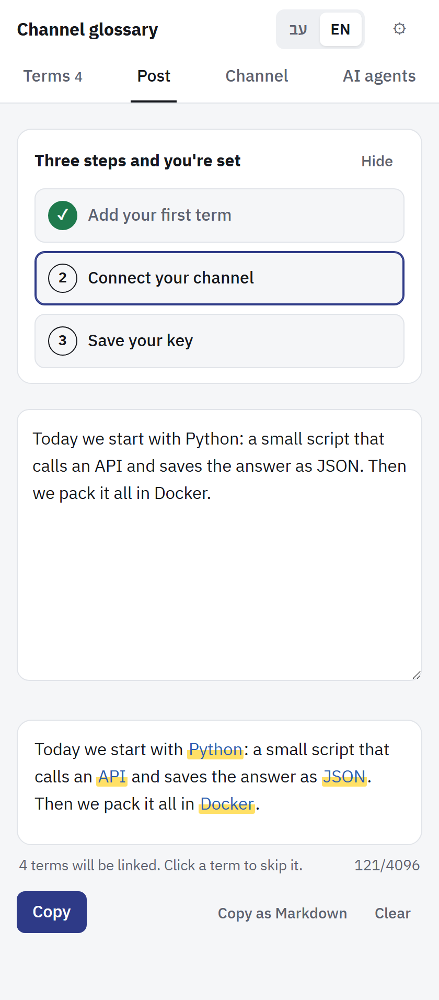
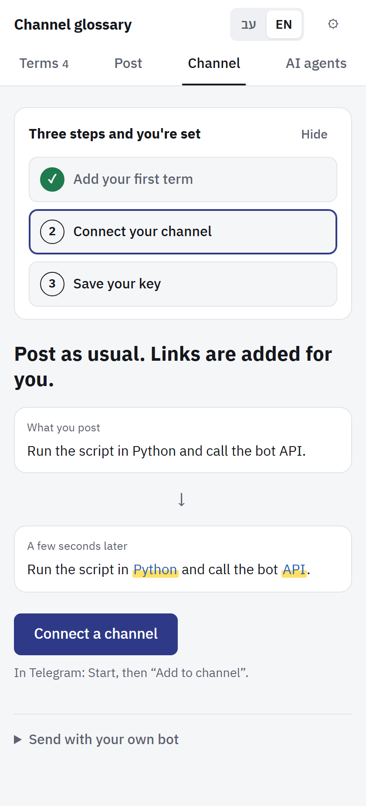
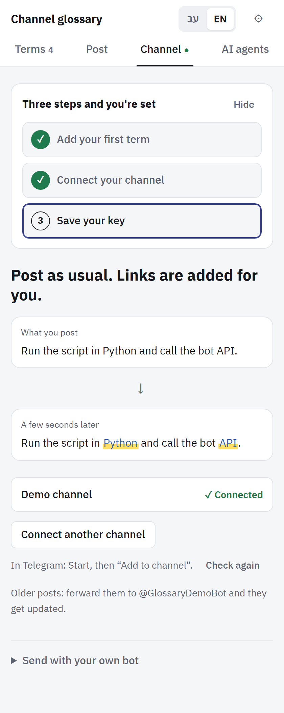
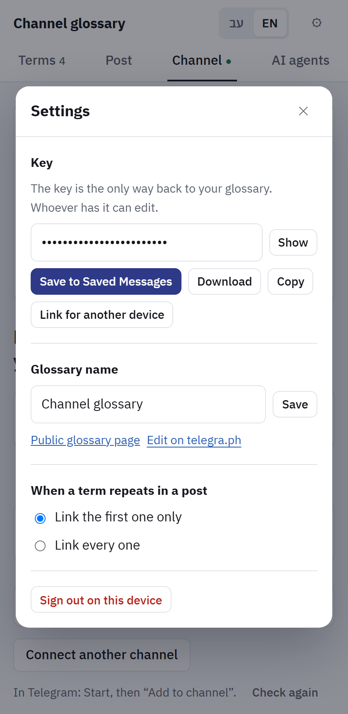

# Getting started: a walkthrough

From an empty page to a Telegram channel whose posts link every term to its explanation.
Hebrew version: [GUIDE.he.md](GUIDE.he.md). Open the web app:
https://nehoraihadad.github.io/telegraph-glossary/

## 1. Open the app

No sign-up. The page shows how it works and asks for a name.

## 2. Name your glossary

Type a name and press **Create glossary**. It is stored on Telegraph, free.

## 3. Your empty glossary

The checklist shows what is left: add a term, connect a channel, save your key.

## 4. Add a term

Write the term and a short explanation. In **Other forms**, add plurals, other-language names or
abbreviations, separated by commas. Hebrew prefixes (like בפייתון) are matched automatically.

## 5. Add a few more

Each term becomes its own Telegraph page, which opens instantly inside Telegram.

## 6. Try a post

In the **Post** tab, paste or write a post. The terms that will be linked are marked. Click a
mark to skip that one. **Copy** gives you the post with its links, ready to paste into Telegram.
This is all you need if you don't have a channel.

## 7. Connect your channel

In the **Channel** tab, press **Connect a channel**. A Telegram link opens.

**In Telegram:**

1. The link opens the bot. Press **Start**.
2. The bot offers **Add to channel**. Press it and pick your channel.
3. Keep the **Edit messages** right switched on. The bot needs it to add the links.

Then go back to the app. If it does not update by itself, press **Check again**.

## 8. Connected

The channel is listed as connected. From now on, post as usual: within seconds the bot adds
the links. When you add or change a term, earlier posts are updated too.

Older posts, from before you connected: forward them to the bot and it updates the originals.

You can also open the app inside Telegram, as a Mini App: send `/app` to the bot, or use its
menu button. Telegram signs you in and keeps your key in your own cloud storage.

## 9. Save your key

The key is the only way back to your glossary, and whoever has it can edit it. Save it to Saved
Messages, download it, copy it, or copy a link for another device. The bot never sees it.

## More

* AI agents (Claude Code, Codex, Gemini CLI and others) can manage the glossary through the
  **AI agents** tab. See the [README](../README.md).
* Regenerate these images: `NODE_PATH=$(npm root -g) node e2e/guide.cjs`. It runs offline, with
  a fake Telegraph and a fake bot.
